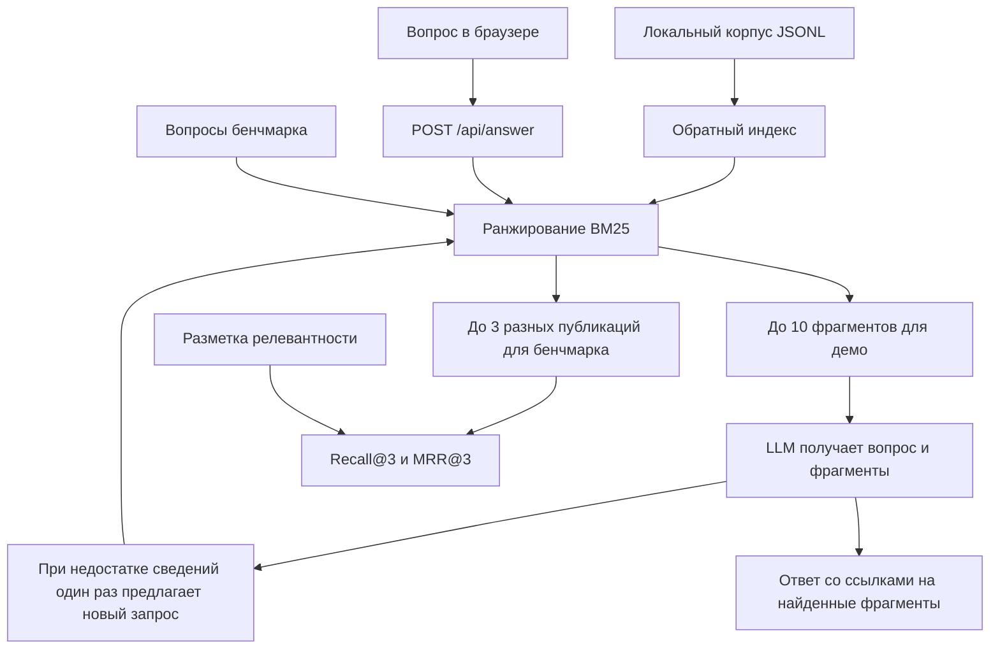

# Техническая документация

Демо, CLI и бенчмарк загружают один корпус из `data/corpus.jsonl.gz` и используют общий поисковый модуль. Демо передаёт найденные фрагменты языковой модели. Бенчмарк сверяет первые результаты с разметкой по публикациям. [Запуск и проверка](../README.md) · [Результаты бенчмарка](../reports/README.md)



## Корпус и происхождение данных

Снимок источников версии 1.6 от 19 ноября 2026 года содержит 4 097 публикаций и разделов. В него входят 1 288 действующих редакций законов и кодексов, 250 справочных публикаций и разделов и 2 559 документов из реестра официального опубликования Банка России. Справочная часть включает разъяснения Банка России, материалы ФНС и Финкульта, датированные значения ключевой ставки и официальных курсов валют. [Рубрикатор Банка России](https://www.cbr.ru/faq/) · [ЭБПИ](http://actual.pravo.gov.ru/) · [Реестр официальных публикаций](https://www.cbr.ru/analytics/na_vr/)

Готовый файл хранится в проекте в формате JSONL с gzip-сжатием. Для чтения достаточно стандартной библиотеки Python. Каждая строка представляет публикацию с полями `document_id`, `url`, `title`, `kind` и необязательным `references`. Элементы массива `passages` содержат `section`, `text` и необязательные `url` и `updated`. `passage_id` формируется из ID публикации и порядкового номера фрагмента.

## Индекс и ранжирование

1. Для каждого фрагмента формируется индексируемая строка из названия, раздела, текста и реквизитов. Исходный поисковый текст остаётся доступен в выдаче.
2. В обоих режимах текст приводится к нижнему регистру, нормализуются Unicode, `ё` и тире. Частые служебные слова отфильтровываются. Варианты `115 фз`, `115ФЗ` и `115-ФЗ` индексируются как один токен `115-фз`.
3. В режиме `stem` Snowball обрабатывает токены из русских букв. Например, слова «банки» и «банков» сводятся к `банк`. Токены с числами, включая `115-фз`, передаются в индекс в нормализованном виде. [Русский алгоритм Snowball](https://snowballstem.org/algorithms/russian/stemmer.html)
4. Обратный индекс хранит список фрагментов и частоту термина в каждом из них. Длина фрагмента и средняя длина вычисляются по индексируемым токенам. При запросе просматриваются списки совпавших терминов.
5. Баллы фрагментов внутри индекса каждого типа сортируются по убыванию. При равенстве используются ID публикации и фрагмента. В бенчмарке каждая публикация занимает одно место по баллу лучшего фрагмента. Для контекста генерации можно запросить несколько фрагментов из одной публикации. Запрос без совпадений возвращает пустой список.

Для множества уникальных токенов запроса $Q$ и фрагмента $d$ используется формула

$$
\mathrm{BM25}(d,Q) = \sum_{t\in Q} \ln\left(1 + \frac{N-df_t+0.5}{df_t+0.5}\right)
\frac{tf_{t,d}(k_1+1)}{tf_{t,d}+k_1(1-b+b|d|/\overline{|d|})}.
$$

Здесь $N$ — число фрагментов, $df_t$ — число фрагментов с термином, $tf_{t,d}$ — его частота в данном фрагменте. $|d|$ обозначает длину фрагмента, $\overline{|d|}$ — среднюю длину. Значения по умолчанию составляют $k_1=1{,}2$ и $b=0{,}75$. Первый параметр регулирует вклад повторений термина, второй — влияние длины фрагмента. Баллы используются для упорядочивания результатов одного запроса.

## Формат бенчмарка

В `data/questions.jsonl` записаны `query_id`, `split`, `topic`, `question` и словарь `relevant`. Ключ словаря — ID публикации, значение — основание релевантности. Связь ставилась, если материал содержит прямой ответ или существенное правило, условие либо исключение для ответа. Простое совпадение темы не даёт релевантности. Первичная разметка подготовлена до прогонов по содержанию источников. Для версии 1.1 ИИ повторно сверил связи контрольной выборки по публикациям Банка России. Дата и охват этой проверки, а также статус проверки человеком хранятся в `data/dataset.json`. [Лист разметки](relevance-review.md)

Три вопроса `dev` служат для отладки. В контрольном наборе `test` 15 вопросов, у каждого указано минимум три эталонные публикации. По требованиям курса разметку подтверждает человек. На этапе поиска в индекс передаётся текст запроса. При подсчёте метрик бенчмарк использует размеченные ID. Бенчмарк использует готовый корпус и то же ранжирование, что и демо. При сравнении `basic` и `stem` меняется токенизация. Корпус, вопросы, параметры $k_1$, $b$ и глубина $k=3$ одинаковы.

- **Recall@k** — доля всех размеченных релевантных документов, найденных в первых $k$ позициях. Если релевантных источников больше $k$, потолок для вопроса равен $k/|R|$.
- **RR@k** — обратный ранг первого релевантного документа. Значение равно нулю при отсутствии релевантных результатов в первых $k$ позициях. **MRR@k** — среднее RR@k по вопросам.

Итоговый Recall@k усредняется по вопросам. Отчёт содержит SHA-256 корпуса и вопросов, параметры, выдачу и пропущенные релевантные ID. Разметка относится к прежним 15 вопросам и публикациям, отмеченным при их подготовке. Добавленные материалы проверялись сценарными запросами. [Отчёт и ограничения оценки](../reports/README.md)

## Интерфейс для команды

Команда интеграции может построить индекс один раз и использовать его при обработке запросов. Из корня репозитория доступен следующий вызов.

```python
from cbr_bm25 import CORPUS_PATH, SearchIndex, load_corpus

index = SearchIndex(load_corpus(CORPUS_PATH), tokenizer="stem")
hits = index.search("Как подать заявление на самозапрет?", top_k=3)
```

Каждый `Hit` содержит `score` и `passage`. В `passage` доступны `document_id`, `passage_id`, `title`, `url`, `kind`, `section`, `text`, `references` и `updated`. CLI выдаёт эти поля в JSON и добавляет `rank` от 1.

## Демо для контрольной точки

`python -m demo` запускает локальную страницу на `127.0.0.1:8765`. Индекс создаётся при запуске и использует Snowball. Для ответа BM25 подбирает до десяти фрагментов, максимум по пять с одной страницы. В сообщение модели входят исходный вопрос и пронумерованные фрагменты с доступными датами обновления. Браузер связывает номера из ответа с адресами из корпуса.

Модель может вернуть строку `ПОИСК: запрос`, когда ей требуется уточнить термины. Сервер запускает тот же BM25 по краткой переформулировке, объединяет новые результаты с частью исходной выдачи и повторно запрашивает ответ на исходный вопрос, если контекст изменился. Если быстрый режим DeepSeek сообщает о недостатке сведений при непустой выдаче, сервер один раз перепроверяет ответ с обычным режимом рассуждения. Уточнение и перепроверка могут увеличить время сложного запроса до трёх вызовов модели. Бенчмарк измеряет прямую выдачу BM25 по исходному запросу.

### Контракт HTTP

`POST /api/answer` принимает `application/json` с полем `question` длиной от 1 до 1 200 символов после удаления пробелов по краям. Размер тела ограничен 8 192 байтами. Если браузер отправляет заголовок `Origin`, он должен совпадать с адресом демо.

```bash
curl -sS http://127.0.0.1:8765/api/answer \
  -H 'Content-Type: application/json' \
  -d '{"question":"Как считается показатель долговой нагрузки?"}'
```

Для принятого запроса API возвращает HTTP 200 и поля `status`, `provider` и `sources`. Дальнейшие поля зависят от результата.

| `status` | Что возвращается |
| --- | --- |
| `answered` | `answer`, фактический ID модели в `model` и процитированные источники. |
| `insufficient` | Сообщение о недостатке сведений в `answer`, ID модели в `model` и пустой список источников. |
| `no_matches` | Пустой список источников. Модель может предложить новый запрос, если исходная выдача пуста. |
| `generation_error` | Сообщение в `error` и до трёх первых результатов поиска. |

Источник содержит `number`, `document_id`, `title`, `kind`, `section`, `text`, `url` и `updated`. Поле `updated` имеет формат `YYYY-MM-DD` или значение `null`. Для `effective_law` это дата начала действия редакции, для `archive_publication` — дата официального опубликования. `number` соответствует номеру фрагмента в контексте, поэтому в списке цитат возможны пропуски.

Ошибки обработки запроса возвращают поле `error`. HTTP 400 означает неверный JSON или недопустимый вопрос, 403 — несоответствие адреса или источника запроса, 415 — неподдерживаемый тип тела. Проверка цитат подтверждает наличие указанных номеров в переданных фрагментах. Фактическую точность ответа проверяют по текстам источников.

Демо использует DeepSeek V4.1 Flash 1017 через Coarena. Быстрый режим запускается без внутренних рассуждений (`reasoning_effort=none`) и с ограничением ответа в 1 200 токенов. Модель получает все отобранные фрагменты. Перед генерацией `GET /api/v1/limits` проверяет бесплатный план аккаунта. Сервер читает `COARENA_API_KEY` из окружения или локального `.env`. Параметр `--model` позволяет выбрать другую поддерживаемую бесплатную модель Coarena. Поиск и бенчмарк выполняются локально. При генерации вопрос и найденные фрагменты отправляются в Coarena. [Документация Coarena](https://coarena.ai/docs)

## Действующие редакции и архив

Поиск строит из единого файла три индекса в памяти по типам источников. Точный запрос по закону, статье и пункту поднимает совпавшую норму. Запрос первоначальной публикации поднимает архивные результаты, а указанный номер положения, указания или инструкции сужает поиск до указанного акта. В обычном запросе поиск сначала отбирает до четырёх справочных результатов, затем до четырёх фрагментов из действующих редакций и до двух архивных фрагментов. Свободные места заполняются остальными справочными результатами. BM25 ранжирует документы внутри каждого типа. Бенчмарк запрашивает до трёх публикаций, демо получает до десяти фрагментов.

ЭБПИ предоставляет полные действующие редакции с датой начала действия. Для законов № 283-ФЗ о сервисе рассрочки и № 282-ФЗ о цифровых валютах каталог подтвердил действие исходного текста без изменений. Эти законы добавлены по номеру и дате подписания. 44 записи основной выгрузки остались без полной редакции в исходном снимке. [ЭБПИ](http://actual.pravo.gov.ru/)

Все 2 559 записей реестра с 4 февраля 2016 года по 17 ноября 2026 года включены в корпус. При сборке получен текстовый слой 40 114 страниц. Ещё 48 099 страниц обработаны локальным распознаванием Apple Vision, текст найден на 47 994 из них. Остальные 105 страниц проверены по растровым изображениям и оказались почти пустыми. Каждый документ архива представлен текстом и реквизитами. Фрагменты снабжены ссылкой с `#page`, текст OCR дополнительно помечается в выдаче.

Архив хранит первоначальные публикации и отдельные акты об изменениях. Для вывода о действии нормы нужна сводная редакция на нужную дату либо применимое официальное разъяснение. Реквизиты и числа в распознанном тексте следует сверять с оригиналом. [Правовые акты Банка России](https://www.cbr.ru/na/) · [Официальное опубликование](https://www.cbr.ru/analytics/na_vr/)

### Подготовка снимка

Справочные материалы и действующие редакции подготовлены из HTML. Текстовый слой PDF извлечён с помощью Poppler, сканы обработаны Apple Vision на macOS. При сборке проверены схема данных и наличие всех источников из разметки. Готовый `data/corpus.jsonl.gz` входит в комплект и используется сразу при запуске демо, поиска или бенчмарка. [Инструкция по запуску](../README.md)

## Ограничения

Демо использует снимок корпуса. Текущее значение ставки или курса доступно на даты, представленные в статистических таблицах. Метрики бенчмарка описывают попадания в текущую разметку. Для новых публикаций по прежним вопросам нужна отдельная оценка релевантности. Для генерации требуется доступная квота выбранного провайдера.
